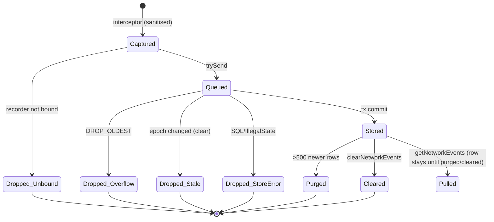

# Design: SDK network event capture (spice-coaching-android#21, parent leapwell#14), SDK half of contract v1

I read everything in this repo read-only, on branch `feat/21-network-event-capture` (HEAD `92444ca` = `origin/development`, tree clean). I also read the app worktree `<local-path>` @ `7c63f4b7`. I opened no env, `local.properties` or key files.

To pin down how the Dart reference behaves, I ran it unmodified (Dart 3.12.2) on about 80 edge inputs. This ran in the scratchpad only and changed nothing in either repo. The vectors file had 109 cases at design time and now has 153 (44 parser-quirk cases were added in the app repo, commit 298a9904), `vectors_version` 1, last changed in `fe50b6b0`, SHA-256 `df4218c144aa6627a4afb32cd29fdea19c621b4cddf97384a66eca15d2cc9955`.

---

## 1. Intent and why
The app's hidden Network page shows every Dart request. The coaching SDK makes its own OkHttp requests natively (module sync, presign, asset and PDF downloads, model download, size probe), often from WorkManager with no Flutter engine running. Those requests never show up. This change:
- records them in the SDK's own Room database, already sanitised and bounded;
- exposes them through a pull API that the app's plugin (Task 9b) maps onto MethodChannel contract v1.

## 2. Goals
- G1. One row per call on the four SDK clients, with the 7 contract fields. Covers 2xx, 3xx, 4xx, 5xx, timeouts, connect errors and cancels.
- G2. The URL is sanitised in Kotlin, passing all 153 shared vectors, before it is queued or stored. No raw URL or query value is ever persisted.
- G3. Recording never blocks, fails or changes a call. Storage failures are swallowed with a log line that gives only the exception type.
- G4. The table holds at most 500 rows, purged in the same transaction as each insert.
- G5. `getNetworkEvents(afterId, limit)` and `clearNetworkEvents()` are public, never throw, and work for rows written by workers.
- G6. A source-scan test fails when someone adds a new OkHttp client without instrumenting it.

## 3. Non-goals and anti-goals
- No push to Dart and no channel code in this repo (D-a, D-b).
- No headers, bodies, exception messages, user ids or final redirect URL in v1. (`final_url` could be added later as an optional field.)
- **Not captured in v1.** Each is documented and listed in the registry test as an exception:
  - ExoPlayer streaming of presigned media (`ui/video/ExoPlayerSurface.kt:49-50`, platform `HttpURLConnection` via `DefaultHttpDataSource`).
  - Coil's own OkHttp for remote avatars (`ui/common/AvatarCircle.kt:57-58`; today the only caller is stub leaderboard data, `ui/leaderboard/LeaderboardDataSource.kt:23`). All other Coil uses load local files from AssetCache (`RichImageBlock.kt:112`, `ModuleThumbnail.kt:51`, `BadgeArtwork.kt:71`, `VideoThumbnail.kt:56,66`, `ImageZoomScreen.kt:47-48`).
  - The OTLP exporter's internal OkHttp (`domain/telemetry/TelemetryManager.kt:91-104`). Its builder takes no client, and the host turns telemetry off (`MainApplication.kt:128`).
  - The ML Kit model download (`ai/translation/OnDeviceTranslator.kt:97`, Play services).
  - `sdk-android-sherpa/build.gradle.kts:49`, which is a build-time `URL.openStream` only.
- No toggle (always on, D-d). No refactor into one shared client factory. No fix for `HttpLoggingInterceptor` (reported only, §9).

## 4. Constraints
- Engineering Design Standards: layered packages, one home for every constant (contract field names, vocabulary, caps), narrow catches, no hardcoded config. There are no user-facing strings.
- This is a guest library. It is not minified (`build.gradle.kts` release `isMinifyEnabled=false`), so its `android.util.Log` calls reach the host's release logcat. `consumer-rules.pro` has no `-assumenosideeffects` rule for Log.
- **Test toolchain today: JUnit 4 only.** No MockWebServer, Robolectric, room-testing or coroutines-test (checked imports across the 123 test files). `unitTests.isReturnDefaultValues = true`.
- **CI** (`.github/workflows/ci.yml`) runs only on push or PR to `main`. PRs to `development` get no CI, so a human must run the verify commands locally.
- Room is at version 36 on `development` and `leapwell-main` (35 on `main`). There is no schema export (`exportSchema = false`) and no migration tests. Migrations are hand-written to mirror Room's `createAllTables` (`MIGRATION_35_36.kt` KDoc).

## 5. Approaches considered

| Choice | Chosen | Rejected (reason) |
|---|---|---|
| Capture point | **OkHttp application interceptor `NetworkEventInterceptor`, added last among application interceptors, plus a small network-interceptor `ConnectionProbe`.** Both are installed by one helper, `NetworkEvents.instrument(builder)`, at each client builder. | **Network interceptor only:** OkHttp runs network interceptors only after `ConnectInterceptor`, so connect failures (DNS, refused, connect timeout, TLS or bad certificate) are never seen. It would also give one row per redirect hop. **EventListener:** a single slot per client, many callbacks, more code than the contract needs. **Central client factory:** changes timeouts and pools on four clients for a diagnostics feature. |
| Timeout phase | `ConnectionProbe` (network interceptor) marks the `Call` as connected in a concurrent set. The application interceptor reads and clears the mark. A `SocketTimeoutException` is `receiveTimeout` if connected, otherwise `connectionTimeout`. | Matching on exception message text: it differs between JVM and Android ("connect timed out", "failed to connect … after", "timeout") and reads messages we promised not to depend on. |
| Writer | A process-wide `NetworkEventRecorder`: a bounded `Channel(256, DROP_OLDEST, onUndeliveredElement = drop counter)`. Producers call `trySend`, which never suspends. One consumer coroutine on `Dispatchers.IO` drains up to 64 events into one Room transaction that also purges. A `Mutex` serialises writes and clears, and an `epoch` drops stale events. | Synchronous insert on the OkHttp thread (blocks the call, breaks D-d). One `launch` per event (unbounded fan-out, no batching or ordering). In-memory ring only (lost on process death, misses worker runs). |
| URL parser for the sanitiser | **Own small parser** porting the parts of Dart's `Uri.parse` that matter (§7f). | **OkHttp `HttpUrl`** fails at least 8 of the 109 original vectors (details in §7f). **`java.net.URI`** fails at least 3 vectors and throws on inputs Dart accepts. |

## 6. Decisions recorded (owner, not reopened)
- **D-a.** Pull model; Room store of about 500 rows (pinned to 500); no native-to-Dart push.
- **D-b.** The channel lives in the app's `MicroCoachingPlugin.kt` (Task 9b). This repo exposes Kotlin `getNetworkEvents` and `clearNetworkEvents` (signatures in §7g).
- **D-c.** Exactly the 7 fields, `sdk_event_version` 1, `status` `ok|notInitialized`, the fixed `error_type` vocabulary, duration measured to response headers, cache-only responses skipped, autoincrement ids, wall-clock `started_at_ms`.
- **D-d.** Always on; must never block, fail or change a call; storage failures swallowed with a type-only log.
- **D-e.** Only the 7 fields; never a raw URL or query value.
- **D-f.** The Kotlin `UrlSanitizer` passes every vector, asserts `vectors_version == 1`, and checks idempotence over every input.

---

## 7. Design

### 7a. Transport inventory (verified)

| # | Transport | Client built at | Used at | Install? |
|---|---|---|---|---|
| 1 | API client: Retrofit `CoachingApiService` over OkHttp | `network/NetworkModule.kt:86-129`. Builder at :87, auth interceptor :90-116, `HttpLoggingInterceptor` :118-126, `build()` :128. Held once at `MicroCoachingSDK.kt:656` (`okHttpClientLazy`), :663, `apiService` :666. `createApiService(config, client = createOkHttpClient(config))` at `NetworkModule.kt:138-150` also goes through the same factory. | Sync workers reuse it (`sync/InboundSyncWorker.kt:48-51`, `sync/OutboundSyncWorker.kt:58-63`); presign at `network/MediaUrlResolver.kt:74`; dashboards; online chat | **Yes.** `NetworkEvents.instrument(builder)` immediately before `builder.build()` at :128, so it is the innermost application interceptor, after auth and logging. |
| 2 | `AssetCache.downloadClient` (presigned images, PDFs, thumbnails) | `data/asset/AssetCache.kt:66-75` (lazy, one per AssetCache). AssetCache is built at `MicroCoachingSDK.kt:451`. | `AssetCache.kt:272-273` | **Yes**, at the builder. |
| 3 | `ResumableHttpDownloader` (model and STT archive downloads) | **New client per call** at `ai/download/ResumableHttpDownloader.kt:99-102` | :112. Called from `ai/model/ModelDownloadWorker.kt:307` and `ai/voice/stt/SttModelDownloadWorker.kt:60`, both WorkManager. | **Yes**, at the per-call builder. This is the one per-call exception; the cost is negligible per download. Hoisting it to a shared lazy client is a possible follow-up, not part of this change. |
| 4 | `ModelSizeProbe.client` (HEAD and ranged GET) | `ai/model/ModelSizeProbe.kt:40-45` (lazy) | :109-111, :126 | **Yes**, at the builder. |
| 5 | OTLP exporter | inside OTel (`TelemetryManager.kt:93`) | | No (non-goal, §3) |
| 6 | Coil default loader (avatar URL) | Coil singleton | `AvatarCircle.kt:57-58` | No (non-goal) |
| 7 | ExoPlayer `DefaultHttpDataSource` | `ExoPlayerSurface.kt:49` | streams presigned media | No (non-goal; open decision 4) |
| 8 | ML Kit translate download | Play services | `OnDeviceTranslator.kt:97` | No |
| 9 | `import okhttp3.OkHttpClient` in `sdk/hooks/AssessmentSubmittedHandler.kt:74`, `sdk/hooks/ReferralSubmittedHandler.kt:74`, `ai/model/ModelDownloadWorker.kt:21` | **Unused imports.** No client is built (git grep finds no other OkHttp symbol in those files). | | No. Registry marks them inert. |
| 10 | `:app` sample module | no OkHttp, HttpURLConnection or WebView use | | n/a (not shipped) |

No SDK client configures `.cache(...)`, so the cache-skip rule is future-proofing today. The SDK never calls the host's MethodChannel and makes no WebView requests (requirement 8).

### 7b. Interceptor (`network/events/NetworkEventInterceptor.kt`, `ConnectionProbe.kt`, `NetworkEvents.kt`)

```kotlin
internal object NetworkEvents {
    fun instrument(b: OkHttpClient.Builder): OkHttpClient.Builder =
        b.addInterceptor(NetworkEventInterceptor { NetworkEventRecorder.current() })
         .addNetworkInterceptor(ConnectionProbe)
}
```

How `intercept(chain)` works:
1. `val req = chain.request()`. Take `startedAt = clock.wallMs()`, `t0 = clock.monoNs()`, and `epoch = recorder?.epoch`.
2. `val resp = try { chain.proceed(req) }` is the only `proceed`, called exactly once.
   - `catch (e: IOException)`: record a failure, then `throw e`.
   - `catch (e: RuntimeException)`: record `unknown`, then `throw e`.
3. On success: if `resp.networkResponse == null`, do not record (served wholly from cache). Otherwise record:
   - `status = resp.code`;
   - a code outside 100..599 is stored as `null` with error type `unknown`, because Dart would skip such a row (`micro_coaching_service.dart:180`).
4. `finally`: remove the call from the probe set.
5. Recording is wrapped in `try { … } catch (e: RuntimeException) { dropped++ }`. This is a deliberate boundary catch for requirement 5. The original response or exception is always returned or rethrown unchanged.

Fields recorded:
- `method = req.method`
- `url = UrlSanitizer.sanitize(req.url.toString())`, done on the calling thread, so the queue never holds a raw URL
- `started_at_ms = startedAt`
- `duration_ms = max(0, (now − t0) / 1e6)`, i.e. time to headers. It includes connect, TLS and redirect hops and excludes body streaming. A mid-body failure on a 900 MB download is not recorded; this is accepted and documented.

The interceptor never reads headers, the body or `e.message`.

**`error_type` classifier** (pure function, unit-tested). Each enum's wire name is defined once:

| Condition | `error_type` |
|---|---|
| `chain.call().isCanceled()` | `cancel` |
| `SSLPeerUnverifiedException`, or `SSLHandshakeException` with a `CertificateException` in its cause chain | `badCertificate` |
| `SocketTimeoutException` / `InterruptedIOException`, not yet connected | `connectionTimeout` |
| `SocketTimeoutException` / `InterruptedIOException`, connected | `receiveTimeout` (includes send timeouts; the vocabulary has no `sendTimeout`) |
| `UnknownHostException`, `ConnectException`, `NoRouteToHostException`, any other `SocketException`, any other `SSLException` | `connectionError` |
| any other `IOException` or `RuntimeException` | `unknown` |

Redirects give one row with the requested URL and the final status. Retries that OkHttp does silently also give one row, because the application interceptor sees one `proceed`.

### 7c. Data model and migration
New files:
- `data/db/entity/NetworkEventEntity.kt`
- `data/db/dao/NetworkEventDao.kt`
- `data/db/migration/MIGRATION_36_37.kt`

Changes:
- Add the entity and `abstract fun networkEventDao()` to `MicroCoachingDatabase.kt`.
- `MICRO_COACHING_ROOM_VERSION` 36 → 37 (`MicroCoachingDatabase.kt:82`).
- Add `MIGRATION_36_37` to `.addMigrations(...)`.

```sql
CREATE TABLE IF NOT EXISTS `network_event` (
  `id` INTEGER PRIMARY KEY AUTOINCREMENT NOT NULL,
  `started_at_ms` INTEGER NOT NULL,
  `method` TEXT NOT NULL,
  `url` TEXT NOT NULL,            -- sanitised, <= 2048 (guaranteed by UrlSanitizer)
  `status_code` INTEGER,
  `duration_ms` INTEGER NOT NULL,
  `error_type` TEXT)
```

- **No secondary index.** Every read and purge is a primary-key range.
- **No CHECK constraints.** Room cannot express them in `createAllTables`, so fresh installs and upgraded installs would differ. Invariants are enforced in Kotlin instead.
- The migration DDL must byte-match `MicroCoachingDatabase_Impl.createAllTables`, verified by a test (§10).

DAO (suspend, following its neighbours):
- `@Insert insertAll(rows)`
- `purge(keep)`: `DELETE FROM network_event WHERE id <= (SELECT MAX(id) FROM network_event) - :keep`
- `@Transaction insertAndPurge(rows, keep = 500)`
- `after(afterId, limit)`: `SELECT * … WHERE id > :afterId ORDER BY id ASC LIMIT :limit`
- `maxId()`: `SELECT COALESCE(MAX(id),0)`
- `deleteAll()`

AUTOINCREMENT keeps ids monotonic across purges and clears, because `sqlite_sequence` is never reset. Gaps can only make the purge keep fewer than 500 rows, never more.

Side effects of the bump:
- **Every bump triggers a full inbound resync once** (`MicroCoachingSDK.kt:590-604` resets watermarks whenever `lastKnownRoomVersion < MICRO_COACHING_ROOM_VERSION`). This is existing behaviour; it is called out in the PR.
- A downgrade to an older AAR falls under the existing `fallbackToDestructiveMigration(dropAllTables = true)`. I did not verify whether Room 2.7 also applies it to downgrades.

### 7d. Writer, concurrency, process death and workers
`NetworkEventRecorder` is a process-wide object.
- **Binding.** `bind(context)` is idempotent and stores only the application context. The DAO is resolved lazily on the writer thread, so bind never opens the database on the main thread. It is called from:
  - `MicroCoachingInitializer.create` (App Startup, which runs at every process start, including WorkManager wake-ups, before `Application.onCreate`; the app keeps the provider);
  - the `MicroCoachingSDK` constructor (`config.context`).
  - Before bind, events are dropped and counted.
- **Its scope is not `sdkScope`.** `sdkScope` is cancelled on `shutdown()` and re-init (`MicroCoachingSDK.kt:1075-1110`), so the recorder has its own `SupervisorJob + Dispatchers.IO` scope with a `CoroutineExceptionHandler` that logs type-only.
- **Producer:** `trySend`, O(1), never suspends. On overflow the oldest queued event is dropped and counted (`onUndeliveredElement`).
- **Consumer:** `for (first in channel)`, then drain up to 64 events with `tryReceive`, then `writeLock.withLock { val e = epoch.get(); rows = batch.filter { it.epoch == e }; dao.insertAndPurge(rows, 500) }`.
  - Each row's `epoch` is captured when its request starts (interceptor entry) and carried on the row, not read when the row is offered, so a request that started before a clear is dropped even if it finishes after it.
  - It catches `android.database.SQLException` (which includes `SQLiteException`) and `IllegalStateException` (closed DB, failed migration).
  - Each exception type is logged once per process, type only.
- **Process death:** the only loss is the queue, a window of milliseconds, since there is no timer. Committed rows survive.
- **WorkManager:** recorded the same way. Rows written before the SDK is initialised become visible once it is.

### 7e. `getNetworkEvents` semantics (contract §8)
Logic lives in `NetworkEventsReader(isSdkInitialized: () -> Boolean, store)` so it can be tested without building the SDK; the companion function is a one-line delegate.
1. If `!MicroCoachingSDK.isInitialized()` or the store is not bound: `NOT_INITIALIZED`, `events = []`, `maxId = 0`.
2. Clamp: `a = afterId.coerceAtLeast(0)`, `l = limit.coerceIn(1, 500)`.
3. `withContext(IO) { db.withTransaction { rows = after(a, l); max = maxId() } }`. This returns ascending ids, never more than `l`, and an honest `max_id` read in the same transaction (0 when empty).
3a. `read()` takes the writer lock (a deliberate deviation from the first design): a read never sees a half-applied clear.
4. On a store read failure (`SQLException` or `IllegalStateException`): `STORE_ERROR`. The plugin maps this to `result.error`, which Dart turns into `failed` (open decision 6). Nothing throws to the caller.

**Confirmed:** `rawCount` and `lastRawId` are not on the wire. Dart derives them (`native_network_events_result.dart:26-31`, `micro_coaching_service.dart:137-157`). `contract_version` from the request is ignored; the SDK always answers `sdk_event_version` 1, and Dart treats any other value as `unavailable`.

### 7f. Kotlin `UrlSanitizer` (`network/events/UrlSanitizer.kt`)
A line-for-line port of `url_sanitizer.dart`, with the same constants, regexes and order:
- input limit 8192 UTF-16 units (Kotlin `length` is also UTF-16);
- strip the trailing `…` marker, then re-add it;
- `_sanitize`, `_cap`, `_dropPartialToken`.

`Uri.tryParse` is replaced by a `DartUriLite` (about 600 lines once written) that reproduces Dart 3.12.2 (`sdk/lib/core/uri.dart`: `_normalizeRegName` :2555, `_normalizeEscape` :2799, `_makePath` replaceBackslash :2685-2692, `_removeDotSegments` :3028, `_uriDecode` :3629):

1. **Pre-encode non-ASCII, per code point, as uppercase UTF-8 `%XX`.** A lone surrogate becomes `%EF%BF%BD`. Do not use `String.toByteArray`, which writes `?`. (Probed: `x/\uD800y` → `x/%EF%BF%BDy`.)
2. **Scheme:** `[A-Za-z][A-Za-z0-9+.-]*:`, lowercased, must be in `{http, https, ws, wss}`, and must be followed by two characters, each `/` or `\` (Dart's scanner treats `\` as `/` here). Otherwise `<unparsable>` (covers `https:h.test/x`, leading space).
3. **Authority** ends at the first of `/ ? # \`. Dart ends it at a backslash: `https://h.test\@evil.test/x` → `/{id}/x`.
4. **Userinfo** (before `@`): dropped. More than one `@`, or a `[` / `]` in the userinfo → `<unparsable>` (the shared vector named "password containing an at sign", plus probes with a doubled `@` and a bracket in the userinfo).
5. **Host:**
   - `[...]` → validated IPv6 (optional `%25` zone), lowercased, re-wrapped in brackets.
   - Otherwise reg-name normalisation: `%XX` of an unreserved char is decoded; other escapes are kept; a bad `%` becomes `%25`; a gen-delim (`: / ? # [ ] @`) → `<unparsable>`; other non-reg-name ASCII → `%XX`. Then lowercase the whole host with `Locale.ROOT`.
   - Empty → `<unparsable>`.
   - Covers vectors `%2e` host → `h.test`, IDN → `b%c3%bccher`, and probes `h test` → `h%20test`, `H%41` → `ha`.
6. **Port:** the text after `:`. Empty means no port. Parse with a Dart-compatible `int.tryParse` (accepts `+`/`-` and hex like Dart; no range check, so `65536` is kept; overflow → `<unparsable>`; `8080:90` → `<unparsable>`). Emit only if it differs from the scheme default (`0443` → dropped; probes `:00` → `:0`, `:+80` → `:80`).
7. **Path:**
   - `\` → `/`.
   - Escape normalisation: an unreserved escape is decoded, so `%2e` becomes `.` before dot handling; a bad `%` becomes `%25`; other escapes are uppercased; non-path ASCII → `%XX`.
   - Then Dart's `_removeDotSegments` exactly. Probes: `/a/..` → `/`, `/.%2E/a` → `/a`.
   - An empty path stays empty (`https://h.test`).
8. **Segment rule:**
   - `decodeStable` runs at most 8 passes while `%[0-9a-fA-F]{2}` is present.
   - Each pass is a **hand-written strict decoder** matching Dart `_uriDecode`:
     - any char above 127 fails;
     - `%` not followed by two hex digits fails;
     - the bytes must be **strict UTF-8**: overlong, surrogate (ED A0 80), truncated and > U+10FFFF sequences fail;
     - a single **leading BOM is stripped**, as Dart's `utf8.decode` does (probe: `%EF%BB%BFa` → `a`).
   - A failure, or an escape still present after 8 passes, gives `{id}`.
   - The decoder is hand-written rather than `CharsetDecoder` because Android's charset implementation may differ from the JDK's on malformed input; a hand-written decoder behaves the same on the JVM and on device.
   - Sensitivity:
     - `@`, `＠`, `﹫` or `;`;
     - a UUID anywhere, or 32 hex characters;
     - `\p{Nd}{6,}`;
     - 7 or more `\p{Nd}` in total. `java.util.regex` and ICU both count code points, so supplementary digits work (probe: math digits → `{id}`).
   - A decoded segment equal to `{id}` stays `{id}`. Otherwise re-encode with Dart's `encodeComponent` set (`A-Za-z0-9-_.!~*'()` literal, everything else uppercase `%XX` of UTF-8).
9. **Query:**
   - Raw text between `?` and `#`, split on `&`, skip empty pairs, key = text before the first `=`.
   - Decode the key with `+` → space; an invalid `%` stays literal (Dart pre-normalises it to `%25`). The key must be strict UTF-8 with the leading BOM stripped.
   - **Any key that fails UTF-8 drops the whole query** (probe: `?%E0%A4=1&limit=2` → no query).
   - Keep allowlisted keys once each, in their original order, as `key=<redacted>`.
10. **Cap:** identical to Dart, but the regexes use `\z` instead of `$`, because Java's `$` also matches before a final line terminator. The output is ASCII plus at most one trailing `…`.
11. **Totality:** `catch (e: RuntimeException) → "<unparsable>"`, with a KDoc stating why. Dart catches `Object`.

In production the input is always OkHttp's canonical `HttpUrl.toString()` (http or https, already percent-encoded, IDN already punycode), so most parser quirks never occur in practice. Exact parity matters mainly for the vectors. The app also re-sanitises native rows on merge (app spec §12), so a divergence on an exotic input cannot leak.

**Vectors that cannot be matched by a reasonable implementation: none.** With the parser above, all 153 match. The alternatives fail these concrete vectors:
- **OkHttp `HttpUrl`:**
  - rejects `ws`/`wss` (`realtime websocket query allowlist`, `non default port kept`, `port: ws default 80 dropped`, `port: wss default 443 dropped`, `port: wss non-default kept`);
  - adds `/` to root URLs (`root url without a path`);
  - takes the last `@` (`password containing an at sign` → host `h.test` instead of `<unparsable>`);
  - converts IDN to punycode (both IDN vectors).
- **`java.net.URI`:**
  - a pre-encoded IDN host or `h%2etest` is not a server-based host, so it returns `<unparsable>` (3 vectors);
  - throws on `\` and spaces, which Dart accepts;
  - does not resolve `%2e` dot segments.

Tests: the vectors file is copied byte-identical to `sdk-android/src/test/resources/net_log/url_sanitizer_vectors.json`. The test asserts:
- `vectors_version == 1` and the case count;
- the pinned SHA-256 above (so local edits fail and the copy is refreshed from the app repo);
- each `expected`;
- `sanitize(expected) == expected` (the runner note);
- `sanitize(sanitize(input)) == sanitize(input)` and output length ≤ 2048 for all cases;
- a seeded random-input totality test.

JSON is parsed with `kotlinx.serialization.json`, already on the classpath.

### 7g. Public API (package `com.medtroniclabs.microcoaching.sdk.diagnostics`, kept by `consumer-rules.pro:9`)

```kotlin
// MicroCoachingSDK.companion
suspend fun getNetworkEvents(afterId: Long, limit: Int): NetworkEventsResult   // never throws; runs on IO internally
suspend fun clearNetworkEvents(): NetworkEventsClearResult                      // never throws

enum class NetworkEventsStatus(val wire: String?) { OK("ok"), NOT_INITIALIZED("notInitialized"), STORE_ERROR(null) }
data class NetworkEvent(val id: Long, val startedAtMs: Long, val method: String, val url: String,
                        val statusCode: Int?, val durationMs: Long, val errorType: String?)
data class NetworkEventsResult(val status: NetworkEventsStatus, val events: List<NetworkEvent>, val maxId: Long) {
    val sdkEventVersion: Int get() = SDK_EVENT_VERSION            // = 1, single home
    /** Contract v1 map for StandardMessageCodec; only for OK / NOT_INITIALIZED. */
    fun toContractMap(): Map<String, Any?>   // keys: status, sdk_event_version, max_id, events[{id, started_at_ms, method, url, status_code, duration_ms, error_type}]
}
data class NetworkEventsClearResult(val status: NetworkEventsStatus, val clearedThroughId: Long)
```

The contract field names live once, in `toContractMap`, which the SDK tests against the v1 schema: Long ids, nullable `status_code`/`error_type`, `duration_ms >= 0`.

### 7h. Clearing on user switch (requirement 9) and clock skew (L2)
`clearNetworkEvents()`:
1. `epoch.incrementAndGet()` (before the write lock is taken). Events whose request started before the clear, queued or in flight, carry the old epoch and are dropped at write.
2. `writeLock.withLock { tx { through = maxId(); deleteAll() } }`.
3. Returns `OK(clearedThroughId = through)`.

It works whenever the store is bound (App Startup or SDK init), **even if the SDK is not initialised**. It returns `NOT_INITIALIZED` only if the store is unbound. Ids keep growing after a clear, because `sqlite_sequence` is kept.

After a clear, `max_id` is 0 until a new event arrives. The app sees `max_id < cursor`, resets its cursor to 0, and pulls only rows from after the clear; its unique index prevents duplicates. **L2 is fixed at the source:** future-dated rows from the previous user are deleted, not just hidden behind the time floor.

**The app (Task 9b) should call it on wipe:** the `DbNetworkRequestRecorder` `WipeParticipant.onWipeStarting()` runs `unawaited(MicroCoachingService.clearNetworkEvents())` through a new channel method `clearNetworkEvents`. The existing floor stays as a second defence. The SDK does not clear by itself, for example on a `currentCHWId` change; the app owns the trigger.

### 7i. Sequences

```mermaid
sequenceDiagram
  participant C as Caller (sync/AssetCache/worker)
  participant I as NetworkEventInterceptor (app, innermost)
  participant P as ConnectionProbe (network)
  participant O as OkHttp core
  participant R as NetworkEventRecorder
  participant DB as Room network_event
  C->>I: execute/enqueue
  I->>I: startedAt, t0, epoch
  I->>O: chain.proceed (once)
  O->>P: (after connect) mark call connected
  alt headers received
    O-->>I: Response
    I->>I: networkResponse==null? skip : sanitize url, status, ms
  else IOException
    O-->>I: throws
    I->>I: classify(e, connected, canceled)
  end
  I->>R: trySend(event)  [never blocks; DROP_OLDEST]
  I-->>C: same Response / rethrow same exception
  R->>DB: writer: tx{ epoch filter, INSERT batch<=64, purge keep 500 }
  Note over R,DB: SQLException/IllegalStateException -> swallowed, type-only log
```

```mermaid
sequenceDiagram
  participant D as Dart MicroCoachingService
  participant PL as MicroCoachingPlugin (app, Task 9b)
  participant S as MicroCoachingSDK.getNetworkEvents
  participant DB as Room
  D->>PL: invokeMethod getNetworkEvents {afterId, limit, contract_version:1} (8 s timeout)
  PL->>S: scope(Main).launch { getNetworkEvents(afterId, limit) }
  alt SDK not initialised / store unbound
    S-->>PL: NOT_INITIALIZED, [], 0
  else
    S->>DB: IO tx: rows id>afterId ASC LIMIT clamp(1..500); COALESCE(MAX(id),0)
    DB-->>S: rows, max
    S-->>PL: OK | STORE_ERROR
  end
  PL-->>D: result.success(toContractMap()) on Main | result.error (STORE_ERROR -> Dart failed)
```



### 7j. ADR draft: "SDK network events: application interceptor, Room store, own URL parser"
- **Status:** Proposed. **Date:** 2026-11-26.
- **Context:** the SDK makes requests from four OkHttp clients, including from WorkManager, that the app cannot see. Contract v1 is pull-based. The shared sanitiser vectors encode Dart `Uri` behaviour.
- **Decision:**
  - an application interceptor plus a connection probe, installed by one helper at each builder;
  - Room table `network_event` (v37), capped at 500, written by one bounded writer;
  - companion `getNetworkEvents` / `clearNetworkEvents`;
  - a Kotlin sanitiser built on its own small Dart-compatible parser.
- **Consequences:**
  - a new table and migration, hard to undo once shipped;
  - every new client must call `NetworkEvents.instrument`, enforced by the registry test;
  - vector changes need a coordinated `vectors_version` bump;
  - ExoPlayer, Coil-avatar and OTLP requests stay invisible until instrumented.

## 8. Contract conformance

| Contract rule | Implemented in |
|---|---|
| `id` monotonic autoincrement | `NetworkEventEntity` `@PrimaryKey(autoGenerate)`, AUTOINCREMENT DDL |
| `started_at_ms` wall-clock epoch ms | interceptor `clock.wallMs()` at entry |
| `method` | `request.method` |
| `url` sanitised, ≤ 2048 | `UrlSanitizer` in the interceptor, before queueing |
| `status_code` int or null | `response.code`; null on exception or a code outside 100..599 |
| `duration_ms` to headers, ≥ 0 | `nanoTime` around `proceed`, `coerceAtLeast(0)` |
| `error_type` vocabulary | `NetworkErrorType` enum (single home) and the classifier |
| cache-only responses skipped | `networkResponse == null` check |
| `id > afterId`, ascending, ≤ limit, clamps | `NetworkEventsReader` and `NetworkEventDao.after` |
| honest `max_id` (or 0) | `COALESCE(MAX(id),0)` in the same transaction |
| `notInitialized`, never throw | reader checks `isInitialized()` and binding; `STORE_ERROR` instead of an exception |
| `sdk_event_version` 1 | `SDK_EVENT_VERSION` constant, `toContractMap` |
| `result.success` on main thread | plugin sketch (§11), app Task 9b |
| `rawCount` / `lastRawId` | not on the wire (Dart-derived), confirmed |

## 9. Security checklist (app spec §13, requirements 1-10)
1. **Sanitiser before write, all vectors, idempotence, cap-cut.** §7f. The sanitiser runs in the interceptor, so the queue never holds raw URLs. The vector, SHA-256 and idempotence tests are in §10.
2. **Only the 7 fields.** The entity has only those columns. The interceptor API never touches headers, body or message. A test sends Authorization and a body, then asserts none of the stored fields contains them.
3. **No Logcat of URLs from the interceptor in release.** The interceptor and recorder log only exception type names, once each. A source-scan test forbids `Log.` calls in `network/events/` that interpolate `url` or `request`.
4. **Bounded.** 500 rows, purged in the insert transaction; URL ≤ 2048 guaranteed by the sanitiser.
5. **Off main thread, never blocks or fails, `proceed` exactly once.** `trySend` plus an IO writer, a boundary catch around recording, and a test counting `proceed` calls.
6. **`getNetworkEvents` semantics.** §7e.
7. **Monotonic ids, wall-clock time, no re-stamping.** §8.
8. **Network layer only.** Cache-only responses skipped. The SDK makes no calls to the host channel.
9. **Clear on user switch.** `clearNetworkEvents()`, §7h.
10. **App-private, not exported, backup excluded.**
    - The store lives in Room `microcoaching.db` under app-private `databases/` (`MicroCoachingDatabase.kt` `Room.databaseBuilder`).
    - No ContentProvider exposes it: `CoachingFileProvider` shares only `asset_cache/` (`res/xml/microcoaching_file_paths.xml`), with `exported=false`.
    - The SDK manifest sets no backup attributes. The host sets `allowBackup="false"` and `fullBackupContent="false"` (`uhis_lf_mobile android/app/src/main/AndroidManifest.xml:86-88`), and `data_extraction_rules.xml` excludes the `database` domain for cloud backup and device transfer.
    - Caveat for `lw-security`: `microcoaching.db` is plain SQLite, not SQLCipher. This is pre-existing (it already holds chat history). The new rows are sanitised and contain no PHI by construction.

**Existing leaks to fix in this change** (all `android.util.Log`, not gated, so they reach release logcat):
- `network/MediaUrlResolver.kt:58`: presigned URL on cache hit (the one the issue names).
- `MediaUrlResolver.kt:125`: presigned source-document URL on cache hit.
- `MediaUrlResolver.kt:45`: direct `src` URL, which can be presigned.
- `ai/download/ResumableHttpDownloader.kt:117`: full request URL. Also :261 (URL plus `cause.message`).
- `data/asset/AssetCache.kt:275-279`: the first 200 characters of the storage error body. A GCS or S3 signature-mismatch body can echo the string-to-sign and credential scope.
- Low: `MediaUrlResolver.kt:78` (error body) and :96 (`it.message`).

Proposed fix: drop the URL or body, or log `UrlSanitizer.sanitize(url)` and the status code only.

**`HttpLoggingInterceptor` (`NetworkModule.kt:118-126`), report only:**
- Level BODY with Authorization and X-Tenant-Id redacted, gated by `config.enableOtelDebugLogging`. That flag defaults to `false` (`MicroCoachingConfig.kt:91`), and uhis does not set it (`MainApplication.kt:120-140`), so it is **not a release risk for uhis today**.
- It is a latent risk for any host that enables it in release: full URLs, presign responses (which contain signed URLs), chat and telemetry bodies would go to logcat. README:71 recommends `BuildConfig.DEBUG`.
- Suggested follow-up: also require `BuildConfig.DEBUG`, or drop to HEADERS.

## 10. Test strategy
Commands (from `repos.json`): `./gradlew :sdk-android:test`, `./gradlew :sdk-android:assembleDebug`.
- **Lint:** none documented or gated. AGP's default `:sdk-android:lintDebug` exists but is not used. No ktlint or detekt. CI only runs `scripts/check-no-hardcoded-colors.sh`.

**New test dependencies** (`testImplementation` only, so no change to the AAR; flagged, open decision 2):
- `com.squareup.okhttp3:mockwebserver:4.12.0`
- `com.squareup.okhttp3:okhttp-tls:4.12.0` (bad-certificate case)
- `org.jetbrains.kotlinx:kotlinx-coroutines-test:1.10.2`
- `org.robolectric:robolectric:4.14.1` with `@Config(sdk = [34])`
- `androidx.test:core:1.6.1`

**Unverified:** that Robolectric 4.14.1 runs cleanly under AGP 9.1 with compileSdk 36. Pinning `sdk = [34]` sidesteps SDK 36 support. Robolectric downloads `android-all` jars at first run, from Maven Central like any other dependency.

Tests, in task order:

| Test | Kind | Asserts |
|---|---|---|
| `UrlSanitizerVectorsTest` | JVM | §7f: version 1, 153 cases, SHA-256 pin, expected, `sanitize(expected) == expected`, idempotence, ≤ 2048. Plus a seeded random totality test. |
| `NetworkErrorClassifierTest` | JVM | every row of the §7b table, including `SSLHandshakeException` with and without a `CertificateException` cause, and the connected flag |
| `NetworkEventInterceptorTest` | JVM + MockWebServer, capturing sink, fake clock | <ul><li>200, 404 and 500 give one row each with the right fields</li><li>presigned `X-Goog-Signature` URL: no query stored and the signature string appears nowhere</li><li>302 → 200 gives 1 row with the original URL and status 200</li><li>cache hit (client with a temp `Cache`, `max-age`) gives 0 rows; a conditional 304 gives 1 row</li><li>read timeout (`SocketPolicy.NO_RESPONSE`) → `receiveTimeout`</li><li>throwing `SocketFactory` → `connectionTimeout`</li><li>refused port, or a `Dns` that throws `UnknownHostException` → `connectionError`</li><li>untrusted `HeldCertificate` → `badCertificate`</li><li>`call.cancel()` → `cancel`</li><li>throwing sink: call returns 200 with the body intact</li><li>a counting downstream interceptor sees exactly 1 `proceed`</li><li>a 999 status → `null` + `unknown`</li></ul> |
| `NetworkEventRecorderTest` | JVM + coroutines-test, fake DAO | <ul><li>batching (≤ 64 per transaction)</li><li>200 parallel offers give 200 rows</li><li>with the DAO blocked, all 500 calls return within a bound and the drop counter > 0</li><li>a DAO throwing `SQLiteException` or `IllegalStateException` is swallowed and the writer keeps going</li><li>stale-epoch events are dropped</li><li>clear is serialised after an in-flight batch</li><li>unbound recorder drops and counts</li></ul> |
| `NetworkEventDaoTest` | Robolectric, in-memory Room | <ul><li>550 inserts leave the newest 500</li><li>`after` ordering and limit</li><li>`maxId` 0 when empty</li><li>ids keep growing after `deleteAll`</li></ul> |
| `Migration36To37Test` | Robolectric | <ul><li>`sqlite_master.sql` for `network_event` from a Room-created v37 DB equals the SQL from running `MIGRATION_36_37.migrate` on a blank `SupportSQLiteDatabase`</li><li>the migration is idempotent</li><li>`MICRO_COACHING_ROOM_VERSION == 37`</li></ul> |
| `NetworkEventsReaderTest` | Robolectric + Room | <ul><li>not initialised → `NOT_INITIALIZED`, `[]`, 0</li><li>`afterId -5` treated as 0</li><li>limit 0 → 1, limit 10,000 → 500</li><li>empty store</li><li>`afterId` > max returns empty with the real `max_id`</li><li>full store (500 rows) paged in three calls</li><li>store error → `STORE_ERROR`, nothing thrown</li><li>`toContractMap` key set and value types match the v1 schema</li></ul> |
| `ClearNetworkEventsTest` | Robolectric + Room | <ul><li>returns `clearedThroughId`</li><li>empty afterwards</li><li>a stale queued event is not written</li><li>a new event gets an id above `clearedThroughId`</li></ul> |
| Per-client rows | mixed | <ul><li>`ResumableHttpDownloader.download` against MockWebServer (JVM, temp file) records 1 row</li><li>`ModelSizeProbe.probe` (made `internal`) records 1 or 2 rows (HEAD, then the ranged fallback)</li><li>`NetworkModule.createOkHttpClient(config)` (Robolectric context) records 1 row</li><li>an `AssetCache` download (Robolectric, in-memory DB) records 1 row</li></ul> |
| `TransportRegistryTest` | JVM source scan | `sdk-android/src/main/**/*.kt` with comments stripped, scanning for `OkHttpClient.Builder()`, `.newBuilder()` on clients, `HttpURLConnection`, `openConnection`, `ExoPlayer.Builder`, `SubcomposeAsyncImage(`/`AsyncImage(` with a non-file model. The set of (file, count) pairs must equal a registry listing kind and reason (instrumented, non-goal or inert). Instrumented files must contain `NetworkEvents.instrument(`. |
| `NoUrlInLogsTest` | JVM source scan | no `Log.*` line in the fixed files (§9) interpolates a URL, `src` or a response body |

Manual check on a Pixel with a debug build of the app after Task 9b:
1. Run a coaching sync, open a lesson with images or a PDF, and start a model download.
2. Open the Network page. Expect native rows with `timing=headers`.
3. Confirm `adb logcat` shows no presigned query strings.

## 11. Build and hand-off
- **AAR:**
  - Build with `./gradlew :sdk-android:assembleRelease`, which writes `sdk-android/build/outputs/aar/sdk-android-release.aar`.
  - A person copies it to `uhis_lf_mobile/android/app/libs/micro-coaching-sdk.aar` (consumed via `files(...)` at `android/app/build.gradle.kts:152`) in the Task 9b PR, recording the SDK commit SHA in that PR body.
  - Build from the merged `development` commit for app testing. For an app release, build from the commit promoted to `leapwell-main`.
  - `publishToMavenLocal` (README:26-27, 83-86) is optional and not used by the app.
- **Version:** this is new public API plus a DB migration, so it is a minor bump. `0.6.0-SNAPSHOT` → `0.7.0-SNAPSHOT`, in `sdk-android/build.gradle.kts` `SDK_VERSION` buildConfigField and the publishing `version` (both in that file; duplication is pre-existing), README:5 and `docs/ARCHITECTURE.md:4`. Open decision 3.
- **Plugin sketch (app repo, Task 9b; not built here):**
  ```kotlin
  private val scope = CoroutineScope(SupervisorJob() + Dispatchers.Main.immediate) // cancel in onDetachedFromEngine
  "getNetworkEvents" -> {
      val afterId = call.argument<Number>("afterId")?.toLong() ?: 0L   // codec gives Int or Long
      val limit = call.argument<Number>("limit")?.toInt() ?: 200
      scope.launch {
          val r = MicroCoachingSDK.getNetworkEvents(afterId, limit)        // suspends on IO inside the SDK
          if (r.status == NetworkEventsStatus.STORE_ERROR) result.error("NETWORK_EVENTS_FAILED", null, null)
          else result.success(r.toContractMap())                         // Main thread
      }
  }
  "clearNetworkEvents" -> scope.launch {
      val r = MicroCoachingSDK.clearNetworkEvents()
      result.success(mapOf("status" to (r.status.wire ?: "failed"), "cleared_through_id" to r.clearedThroughId))
  }
  ```
  This replaces the spec's plugin-side `isInitialized` check (`MicroCoachingPlugin.kt:91-94` pattern); the SDK does it, so it lives in one place. With the old AAR, `else -> result.notImplemented()` (`MicroCoachingPlugin.kt:425`) gives `MissingPluginException`, which Dart maps to `unavailable`.
- **Compatibility:**

| App | AAR | Result |
|---|---|---|
| old (no handler) | new | SDK records silently (≤ 500 rows); v36 → v37 migration runs plus one full resync; harmless |
| 9a only (no handler) | any | `MissingPluginException` → `unavailable` |
| 9b handler | old | does not compile (the plugin references the new API), so it cannot ship |
| 9b | new | `ok` / `notInitialized`; `failed` on store error |
| app downgraded to old AAR over v37 | | Room downgrade → existing destructive fallback (unverified for downgrades) |

- **`sdk_event_version` policy:** additive optional fields keep 1. A rename, removal, type change or semantic change bumps it to 2, and Dart then shows `unavailable`. The constant lives only in the SDK.

## 12. Risks
1. **Parser parity drift** on inputs outside the vectors. Low impact: production inputs are canonical `HttpUrl` strings, and Dart re-sanitises on merge. Mitigation: open decision 1 (more vectors).
2. **Unicode tables:** `\p{Nd}` on Android ICU may differ from the JDK and from Dart for newly added digit scripts. Accepted. The vectors cover ASCII, Bengali and Arabic-Indic digits; math digits were checked by probe only.
3. **Robolectric toolchain** under AGP 9.1 (unverified). Fallback: move the DAO and migration tests to `androidTest`, which CI cannot run.
4. **No CI on PRs to `development`** (`ci.yml` triggers only on `main`). Verify commands must be run locally and pasted into the PR. A separate small PR could add `development` to the triggers (human decision).
5. **Room bump side effect:** one full inbound resync per upgraded device (`MicroCoachingSDK.kt:590-604`). Existing behaviour.
6. **Mis-classified timeout after a redirect or retry** (the probe marks the call connected from an earlier hop). Cosmetic.
7. **Uncaptured transports** (ExoPlayer, Coil avatar, OTLP, ML Kit). The page will under-report media streaming.
8. **Plain-SQLite store** (pre-existing). The rows are sanitised.
- **Anti-goals:** do not touch client timeouts or auth; do not read headers or bodies; do not add a runtime dependency; do not create a second Room database.

## 13. Branch and PR plan
- Branch `feat/21-network-event-capture` from `origin/development` (already created and clean).
- One PR to `development` with body `Closes #21` and `Refs Medtronic-LABS/leapwell#14`. Commits are Conventional, one per task, with `(#21)`.
- Run `lw-security` and `lw-reviewer` before the PR (L flow, `/lw-feature`).
- Humans then promote `development` → `training` → `leapwell-main`. Never PR `development` straight to `leapwell-main`.

## 14. Task breakdown
Each task starts with a failing test. Verify each with `./gradlew :sdk-android:test --tests '<pkg>.*'`, then the full `./gradlew :sdk-android:test`. Add `./gradlew :sdk-android:assembleDebug` where `main` code or Gradle changes.

| # | Task | Files | Failing test first |
|---|---|---|---|
| T1 | Test toolchain (after decision 2) | `gradle/libs.versions.toml`, `sdk-android/build.gradle.kts` (testImplementation only) | Robolectric smoke: in-memory `MicroCoachingDatabase` inserts and reads one `LearningCompletionEntity` |
| T2 | `UrlSanitizer` + `DartUriLite` + strict UTF-8 decoder; copy the vectors | `network/events/UrlSanitizer.kt`, `network/events/DartUriLite.kt`, `src/test/resources/net_log/url_sanitizer_vectors.json` | `UrlSanitizerVectorsTest` |
| T3 | `NetworkErrorType`, classifier, `NetworkEventSink`, `NetworkEventInterceptor`, `ConnectionProbe`, `NetworkEvents.instrument` | `network/events/*` | `NetworkErrorClassifierTest`, `NetworkEventInterceptorTest` |
| T4 | Entity, DAO, `MIGRATION_36_37`, version 37 | `data/db/entity/NetworkEventEntity.kt`, `data/db/dao/NetworkEventDao.kt`, `data/db/migration/MIGRATION_36_37.kt`, `MicroCoachingDatabase.kt` | `NetworkEventDaoTest`, `Migration36To37Test` |
| T5 | `NetworkEventRecorder` (channel, writer, epoch, bind, clear) | `network/events/NetworkEventRecorder.kt` | `NetworkEventRecorderTest` |
| T6 | Wiring: instrument the 4 builders; bind in `MicroCoachingInitializer` and the SDK constructor; registry | `NetworkModule.kt:128`, `AssetCache.kt:70-75`, `ResumableHttpDownloader.kt:99-102`, `ModelSizeProbe.kt:40-45`, `MicroCoachingInitializer.kt`, `MicroCoachingSDK.kt` | per-client row tests, `TransportRegistryTest` |
| T7 | Public API: `NetworkEventsReader`, companion `getNetworkEvents` / `clearNetworkEvents`, result types, `toContractMap` | `sdk/diagnostics/*.kt`, `MicroCoachingSDK.kt` companion | `NetworkEventsReaderTest`, `ClearNetworkEventsTest` |
| T8 | Log leak fixes (§9) | `MediaUrlResolver.kt`, `ResumableHttpDownloader.kt`, `AssetCache.kt` | `NoUrlInLogsTest` |
| T9 | Docs and version: ARCHITECTURE (v37, 25 tables, the "Network events" section, transport inventory), README version, `SDK_VERSION`; `./gradlew :sdk-android:assembleRelease` and hand-off notes | `docs/ARCHITECTURE.md`, `README.md`, `sdk-android/build.gradle.kts` | n/a (assemble) |

**Size: L.** It adds a Room migration, a new public API used across repos, interceptors on four clients and new test infrastructure.

## 15. Where issue #21's text differs from this design
1. "An empty list when not initialised": the design returns `status: "notInitialized"` with `events: []` and `max_id: 0` (contract v1). A store read failure gives `STORE_ERROR`, which Dart sees as `failed`.
2. `getNetworkEvents(afterId)`: the design is `getNetworkEvents(afterId, limit)` with clamps, **plus `clearNetworkEvents()`** (requirement 9). The issue does not mention it, and it needs a matching addition to app Task 9b (channel method plus a call from the wipe participant).
3. "Four HTTP clients": the design also documents ExoPlayer, the Coil avatar, the OTLP exporter and ML Kit as not captured, and adds a registry test.
4. Test plan: MockWebServer and Room tests need **new test dependencies** (Robolectric, MockWebServer, okhttp-tls, coroutines-test). None exist in the repo today.
5. "Stop logging the presigned URL in the media URL resolver": the design also fixes `MediaUrlResolver.kt:45,125`, `ResumableHttpDownloader.kt:117,261` and `AssetCache.kt:275-279`.
6. "About 500 rows" is pinned to 500, against requirement 4's example of 2,000.
7. "Can land before or after the app part": true for 9a. Task 9b needs this merged and the AAR rebuilt, plus a version bump.
8. No CI runs on PRs to `development`. Local verify output must go in the PR body.

## Open decisions
1. **Add Dart-generated parser-quirk cases to the shared vectors** (in the app repo's canonical file, keeping `vectors_version` 1 because no rule changes). The candidates come from my probes against Dart 3.12.2: leading BOM in a segment or key, lone surrogate, backslash in the path and authority, port `+80`/`00`, host `%41`/`%zz`/space, invalid-UTF-8 query key drops the whole query, `\p{Nd}` math and Arabic-Indic digits, trailing `…`. **Default: yes**, done before T2 copies the file, about 25 cases.
2. **Add test-only dependencies** (Robolectric 4.14.1 with `@Config(sdk=[34])`, MockWebServer and okhttp-tls 4.12.0, coroutines-test 1.10.2, androidx.test core 1.6.1). **Default: yes.** No change to the AAR.
3. **SDK version bump** to `0.7.0-SNAPSHOT`. **Default: yes.**
4. **ExoPlayer streaming capture** via `media3-datasource-okhttp` with an instrumented client. **Default: no for v1**, follow-up ticket. It adds a runtime dependency, and range requests could flood the 500 rows.
5. **Fix the sibling URL and body logs** in the same change (§9), not just `MediaUrlResolver.kt:58`. **Default: yes.**
6. **A store read failure surfaces as `result.error`**, which Dart shows as `failed`, rather than a fake `notInitialized`. **Default: yes.** The wire status enum is unchanged.

Design: an application-level OkHttp interceptor plus a connection probe on the four SDK clients feed a bounded, epoch-guarded single writer into a new Room table `network_event` (v37, 500 rows). Companion `getNetworkEvents` / `clearNetworkEvents` serve contract v1. A Kotlin `UrlSanitizer` on its own Dart-compatible parser passes all 153 vectors. Existing presigned-URL log leaks are fixed. Repos: coaching-android (with a follow-up in mobile Task 9b). Open decisions: 6.